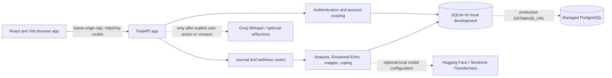

# SentinelText

**A private space for voice journaling and self-reflection.**

SentinelText is a full-stack journaling application that lets a signed-in person record or write reflections, review transparent language-based emotion labels, and explore recurring themes and optional coping activities. It is a self-reflection tool, not a diagnostic or emergency service.

## Problem and objectives

People often want a low-pressure way to record thoughts and revisit patterns over time. SentinelText provides a private, account-scoped journal and makes the analysis understandable: saved language labels and recurring wording are presented as observations, not clinical measurements or explanations of cause.

Project objectives:

- Provide voice and text journaling with user-controlled transcription.
- Keep entries and analysis scoped to an authenticated account.
- Make the analysis method and optional external processing visible.
- Support review, correction, feedback, and deletion of personal journal data.
- Offer a polished responsive interface with persistent light and dark themes.

## Features

- Email signup, login, remembered sessions, logout, and expiring single-use password reset.
- Argon2 password hashes and JWT sessions in HttpOnly cookies.
- Consent-gated microphone recording, audio playback, editable transcripts, and manual journaling.
- Dashboard counts, date filters, recent entries, and recorded emotion trends.
- Emotional Echo groups related saved entries, displays date-filtered counts, and lets users confirm, rename, dismiss, or restore themes.
- Trigger & Relief Mapper groups reviewable situation/emotion/activity associations and supports user-added patterns.
- Coping Intelligence provides optional suggestions grounded in saved entries, confirmed patterns, and user feedback.
- Searchable journal history, per-entry deletion, and deletion of all account journal data.
- Responsive navigation and persisted light/dark theme preference.

## Technology

| Area | Technology |
| --- | --- |
| Frontend | React 19, TypeScript, Vite, Tailwind CSS, Lucide icons |
| Backend | Python, FastAPI, Pydantic, SQLAlchemy |
| Authentication | Argon2 (`pwdlib`), signed JWT, HttpOnly cookie |
| Local database | SQLite |
| Production database | PostgreSQL through SQLAlchemy and psycopg 3 |
| Local language analysis | Keyword lexicon and scikit-learn TF-IDF similarity |
| Optional integrations | Groq Whisper / chat reflections; Hugging Face emotion model; Sentence Transformers |

## Architecture



## Project structure

```text
api/
  index.py                 Vercel adapter for backend.main:app
backend/
  auth/                     Password hashing, sessions, reset email
  routes/                   Authentication and wellness API routes
  services/                 Analysis, Emotional Echo, personalized insights
  tests/                    Backend integration tests with isolated SQLite
  database.py               SQLAlchemy engine and safe table initialization
  models.py                 SQLAlchemy data models
  schemas.py                Request validation
frontend/src/
  components/               Screens, reusable UI, application shell
  hooks/                    Theme hook
  services/                 Authenticated API client
  App.tsx                   Auth state and page orchestration
  *.css                     Design tokens and page styles
eval/                       Existing evaluation artifacts
```

Local SQLite databases and environment files are ignored by Git. `trades.db` is preserved but is not used by SentinelText.

## How the analysis works

The default emotion and topic labels use a transparent local keyword lexicon. These labels can be wrong and are not validated psychological measurements. Emotional Echo uses local TF-IDF cosine similarity to group related journal wording by default. Optionally, `SENTINEL_EMOTION_MODEL` enables a Hugging Face text classifier, and `SENTENCE_TRANSFORMER_MODEL` enables local sentence embeddings. If an optional model cannot load, the app falls back to its local implementation.

Groq Whisper is used only when the user explicitly requests transcription. Optional Groq reflections in Emotional Echo are off by default and require both a configured key and the user's saved consent. Trigger & Relief Mapper and Coping Intelligence use local journal text and saved feedback; they do not send that text to an external AI provider.

## Authentication and privacy

The backend hashes passwords with Argon2 and signs JWT session cookies with `JWT_SECRET_KEY`. Cookies are HttpOnly and SameSite=Lax; `Secure` is enabled by default on Vercel and should be explicitly enabled for any HTTPS deployment. API handlers obtain the account from the verified cookie, not from a client-provided user ID. CORS credentials require an explicit origin list; wildcard origins are rejected.

Local development uses SQLite. **Vercel serverless storage is not persistent**, so a Vercel deployment now requires `DATABASE_URL` pointing to a persistent PostgreSQL database. The application does not copy or publish either existing local SQLite database. Configure a managed PostgreSQL service separately and store its connection string as a private Vercel environment variable. Use its pooled/serverless connection endpoint when provided.

Password-reset email is unavailable until SMTP is configured. Journal audio and transcripts contain sensitive personal data; use a private database, restrict access, and configure backups and retention with your database provider. The app offers deletion of account journal data, but does not currently provide account deletion.

## Local installation and run

Requirements: Python 3.10 or later; Node.js 20.19+ or 22.12+ (required by the current Vite version).

### 1. Backend (PowerShell)

From the repository root:

```powershell
python -m venv .venv
.\.venv\Scripts\Activate.ps1
pip install -r requirements.txt

# Make a random 256-bit local development JWT secret (PowerShell 5 compatible).
$jwtBytes = New-Object byte[] 32
$rng = [System.Security.Cryptography.RandomNumberGenerator]::Create()
$rng.GetBytes($jwtBytes)
$env:JWT_SECRET_KEY = ([BitConverter]::ToString($jwtBytes) -replace '-', '').ToLower()
$rng.Dispose()
$env:COOKIE_SECURE = "false"

python -m uvicorn backend.main:app --reload --port 8000
```

The default local SQLite database is `backend/sentineltext.db`. To use a separate local test database, set `SENTINEL_DB_PATH` before starting the backend. The backend reads environment variables from the process; it does not automatically load `.env`. `.env.example` documents the available variables.

### 2. Frontend

Open a second terminal at the repository root:

```powershell
cd frontend
npm ci
npm run dev
```

Open the Vite URL shown in the terminal, usually <http://localhost:5173>. Vite proxies `/api` to the backend on port 8000. Create an account and sign in. Microphone recording requires a secure browser context (localhost is allowed) and microphone consent in Settings. Transcription additionally requires `GROQ_API_KEY` and a user click on **Transcribe with Whisper**.

Stop the backend and frontend with `Ctrl+C` in their respective terminals.

## Environment variables

| Variable | Required | Purpose |
| --- | --- | --- |
| `JWT_SECRET_KEY` | Yes for authentication | Random signing key, at least 32 characters. Keep it private and stable across instances. |
| `COOKIE_SECURE` | Production: yes (`true`) | Enables Secure cookies. Vercel defaults to `true`; local HTTP development uses `false`. |
| `DATABASE_URL` | Vercel: yes | Persistent PostgreSQL connection URL. Locally omit it to use SQLite. |
| `SENTINEL_DB_PATH` | No | Local SQLite file path override. Do not use SQLite for Vercel user data. |
| `CORS_ORIGINS` | If frontend is cross-origin | Comma-separated explicit origins, for example `https://app.example.com`. Same-origin Vercel routing normally does not need a production CORS entry. |
| `FRONTEND_URL` | Password reset | Public frontend origin used in reset links. |
| `GROQ_API_KEY` | Optional | Enables requested Whisper transcription and consented AI reflections. |
| `GROQ_MODEL` | Optional | Groq chat model; default `llama-3.1-8b-instant`. |
| `GROQ_WHISPER_MODEL` | Optional | Groq transcription model; default `whisper-large-v3`. |
| `SMTP_HOST`, `SMTP_PORT`, `SMTP_FROM` | For reset email | SMTP host, port, and sender. |
| `SMTP_USERNAME`, `SMTP_PASSWORD` | If SMTP provider requires login | SMTP credentials; configure as secrets. |
| `SMTP_STARTTLS` | Optional | Defaults to `true`; set according to the SMTP provider. |
| `SENTINEL_EMOTION_MODEL` | Optional | Hugging Face text classification model id. Install `backend/requirements-ai.txt`. |
| `SENTENCE_TRANSFORMER_MODEL` | Optional | Sentence Transformers model id. Install `backend/requirements-ai.txt`. |

Never commit `.env`, provider credentials, database URLs, or local database files.

## API documentation

With the backend running, open <http://127.0.0.1:8000/docs>. Health endpoints are `/` and `/api/health`. Auth routes are `/api/auth/register`, `/api/auth/login`, `/api/auth/me`, `/api/auth/logout`, `/api/auth/forgot-password`, and `/api/auth/reset-password`. Journal and product APIs include `/api/journals`, `/api/transcribe`, `/api/dashboard`, `/api/echo`, `/api/mapper/patterns`, `/api/recommendations`, and `/api/settings`.

## Testing and quality checks

From the repository root:

```powershell
.\.venv\Scripts\python.exe -m unittest discover -s backend\tests -v
```

From `frontend/`:

```powershell
npx tsc --noEmit --noUnusedLocals --noUnusedParameters
npm run build
```

The backend integration tests use an isolated temporary SQLite database. They do not test a live SMTP provider, Groq account, Hugging Face download, or managed PostgreSQL instance.

## Vercel deployment

Deployment configuration is in the root `vercel.json`, root `package.json`, `api/index.py`, and Python requirements files. The Python adapter imports the canonical FastAPI application from `backend/main.py`. The frontend calls same-origin `/api` routes.

Before deploying, you must:

1. Push the repository to your Git provider and import it into your Vercel account with the repository root as the project root.
2. Provision a persistent PostgreSQL database and obtain its connection URL. Vercel's function filesystem is temporary; a local SQLite file is not suitable for production data.
3. Set the private Vercel environment variables `DATABASE_URL`, a unique random `JWT_SECRET_KEY` (32+ characters), and `COOKIE_SECURE=true` for Production, Preview, and Development environments as appropriate.
4. If the frontend is hosted at a different origin, set `CORS_ORIGINS` to the exact origin(s). Set `FRONTEND_URL` to the deployed frontend origin for reset links.
5. To enable password reset emails, configure `SMTP_HOST`, `SMTP_PORT`, `SMTP_FROM`, and provider-required SMTP credentials/TLS settings. Without these, password reset email is unavailable.
6. Optionally configure `GROQ_API_KEY` for Whisper/reflections and configure local-model settings only if installing the optional AI requirements is supported by the deployment build.
7. Deploy a preview first. Verify `/`, `/api/health`, signup/login/logout, cookie behavior over HTTPS, and database persistence across separate function requests. Only then promote the deployment to production.

Do not add `sentineltext.db`, `trades.db`, `.env`, or secrets to the repository. This project has not been publicly deployed or tested against a live Vercel URL. No live deployment is claimed.

## Screenshots

Screenshots are not included yet. Replace these placeholders with captures from the running application; do not use mockups as proof of implemented behavior.

- Dashboard: _screenshot placeholder_
- Voice and text journaling: _screenshot placeholder_
- Emotional Echo: _screenshot placeholder_
- Trigger & Relief Mapper and Coping Intelligence: _screenshot placeholder_
- Settings and theme controls: _screenshot placeholder_

## Current limitations and future work

- No account deletion flow is currently provided; journal-data deletion is available from Settings.
- SQLite is for local development. Production requires a configured persistent PostgreSQL database.
- External email, Groq, and optional model providers require separate credentials and have not been live-service tested.
- Emotion labels, theme groups, and coping suggestions are reflective aids; they are not clinical measures or medical recommendations.
- A future release could add account deletion/export, a formal schema migration tool, and deployment smoke tests against an isolated staging environment.
